  

  
  
  

I build **AI agents that automate operations**, lower costs and deliver reliable results. My background in data science, RAG and policy evaluation keeps every system measurable and grounded in evidence.

## Now

- **Agentic AI.** Designing and deploying multi-agent workflows for business operations.
- **UN OCHA, Geneva.** AI situation analysis and grounded report generation for humanitarian crises, used in the 2026 earthquake responses in the Philippines, Venezuela and Colombia.
- **Instrumental Partners.** Knowledge graphs, document AI, pricing models and BI for US manufacturing and defense-supply clients.

## Agentic workflows for business

  

**Agent Fleet** is a virtual office where AI agents communicate, coordinate and execute tasks. An orchestrator turns each goal into a plan and assigns the work to specialists in research, engineering, data, writing and operations. Each agent has the tools it needs to interact with its environment. Continuous evaluation runs through an LLM as a judge and human-in-the-loop review.

**Business value**

- **Automation.** Reports, research, data preparation and document review run end to end.
- **Cost efficiency.** Each task runs on a right-sized model with lean context.
- **Quality.** Every output is reviewed, and each finished job improves the next one.
- **Security.** Agents work in sandboxed workspaces, with human approval on key steps.
- **Company memory.** A shared knowledge base grounds every answer in the organisation's own sources.
- **Integration.** Agents connect to existing tools, data and documents.

**Applications:** reporting and BI, procurement, finance and back office, document-heavy processes and research.

## Case studies

<b>AI and data engineering</b>

- [OCHA-RAG: earthquake responses and the reporting module](https://danielnavarro.work/work/ocha-rag/)
- [Company intelligence with a knowledge graph and RAG](https://danielnavarro.work/work/knowledge-graph-company-intelligence/)
- [AI review of quality clauses in purchase orders](https://danielnavarro.work/work/purchase-order-clause-reviewer/) (about $0.02 per order)
- [Machine learning for bid pricing on defense contracts](https://danielnavarro.work/work/bid-price-prediction/)
- [Procurement intelligence with RAG and ML](https://danielnavarro.work/work/procurement-intelligence/)
- [From ERP to dashboards for a manufacturer](https://danielnavarro.work/work/erp-manufacturing-dashboards/)
- [US aviation repair station market map](https://danielnavarro.work/work/aviation-repair-station-market-map/)

<b>Policy research and data science</b>

- [Did Colombia's Total Peace policy reduce violence?](https://danielnavarro.work/work/paz-total-colombia/) (MA thesis) · [code](https://github.com/Daniel-Navarro-M/-I-m-Paz-Total_replication)
- [Parental investment and learning gaps in the Western Balkans](https://danielnavarro.work/work/world-bank-timss-balkans/) (World Bank) · [code](https://github.com/Daniel-Navarro-M/World_Bank_CEU)
- [Haitian migration discourse in the Dominican Republic, an NLP study](https://danielnavarro.work/work/dominican-migration-nlp/) · [code](https://github.com/Daniel-Navarro-M/dialectical_identity_in_RD)
- [Corruption risk in Rail Baltica procurement](https://danielnavarro.work/work/rail-baltica-corruption-risk/) · [code](https://github.com/Daniel-Navarro-M/rail_baltika_corruption_replication)
- [Blackpolis: mapping structural racism in Cali](https://danielnavarro.work/work/blackpolis-cali/) · [code](https://github.com/Daniel-Navarro-M/blackpolis_replication)
- [K-means clustering of Cali's metropolitan vote](https://danielnavarro.work/work/cali-electoral-clustering/)
- [Pesticides and Parkinson's disease: geospatial ML](https://danielnavarro.work/work/parkinsons-geospatial-ml/)

## Tech stack

  

## About

I work across the whole data lifecycle: scraping and APIs, ETL, databases, models, dashboards, and the report someone reads at the end. Most of my projects sit where data engineering meets AI, with an evidence trail behind every answer.

I hold an MA in Public Policy (quantitative policy analysis) from Central European University and a BA in Anthropology from Universidad Icesi. That mix is why I care about who uses a system and whether its numbers can be trusted.

I've worked with the World Bank, UN OCHA, the Organization of American States, the European Union and private-sector clients, in humanitarian response, public procurement, manufacturing, education and security.

**Publications.** Milanese, J. P. & Navarro, D. (2025). *Más allá de los límites municipales: análisis de la metropolización del comportamiento electoral en Cali utilizando K-Means Clustering.* **GEOgraphia**, Brazil. First prize, FLACSO Ecuador TechPolítica contest (2024).

**Languages.** Spanish (native) · English (C1) · Italian (B1) · French (A2)

  

  

